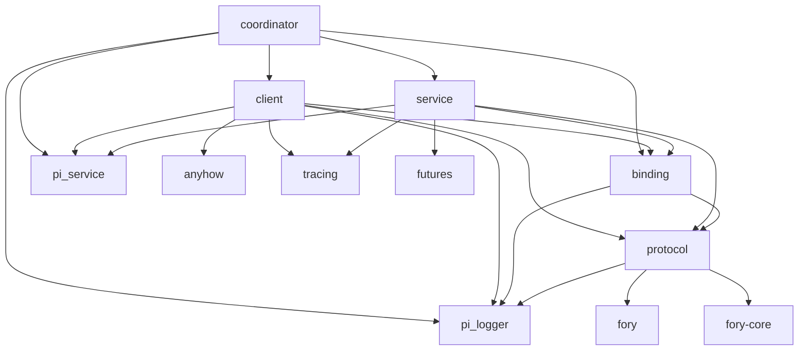
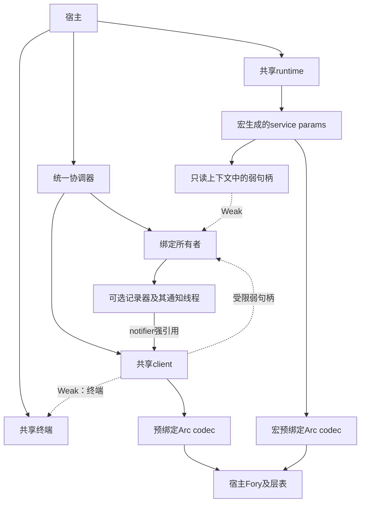

# tracing-coordinator · 依赖、调用与持有（L5）

**状态：定向返工后定稿/冻结，2026-10-16。** 用户确认五模块、21条类型依赖、标准宏typed调用及宿主codec持有合同并进入L7。图是设计预期，不是实际运行或行为证明；后续L7五模块声明均已落地并通过check，见[当前接口](../07-design/api.md#api-index)。旧24边和私有准备关系被显式替代，历史见[日志](../index/changes.md)。

## 类型/编译依赖图

图定位：本册deps；范围为本次触达的候选编译结构，2026-10-16用户确认版。

### 依赖边源表

| 从 → 到 | 允许用途 |
|---|---|
| coordinator → client | 构造和共享发送接入，交付notifier。 |
| coordinator → service | 本库服务上下文、静态注册和初始化接入。 |
| coordinator → binding | 创建唯一所有者，绑定记录器、关闭。 |
| coordinator → pi_service | 接受宿主环境，冷路径预绑定codec，传递装配错误。 |
| coordinator → pi_logger | 身份、上报决定、记录器及现有notifier接口。 |
| client → protocol | 将业务参数转换成唯一消息。 |
| client → binding | 每次发送取得准入结果。 |
| client → pi_service | 使用宿主codec编码，经既有终端提交send。 |
| client → pi_logger | Trace类型与TraceNotifier实现。 |
| client → anyhow | 满足既有notifier返回类型，保留真实错误。 |
| client → tracing | 记录notifier的同步失败。 |
| service → protocol | 命名消息类型，校验类型化参数。 |
| service → binding | 交接已校验结果。 |
| service → pi_service | 标准宏、上下文、静态注册及初始化。 |
| service → tracing | 记录业务入口后的拒绝。 |
| service → futures | 宏生成的futures::future::BoxFuture。 |
| binding → protocol | 消费不可伪造的DecodedSelection。 |
| binding → pi_logger | 保存可选记录器，调用apply_remote_selection。 |
| protocol → pi_logger | 使用既有业务类型，完成表示转换。 |
| protocol → fory | 唯一消息派生和集中类型登记。 |
| protocol → fory-core | 满足ForyObject派生代码的直接引用。 |

**读图说明：** 每条箭头都是类型/编译依赖，逐条对应上表。库内保持coordinator→client/service→binding→protocol的允许方向；protocol不依赖绑定，绑定不反调发送或接收模块。标准库共性不另画成模块，根声明及重导出不表示运行时调用。此图不表达返回数据、所有权、线程或错误时序；对应视角分别见下文。图与源表有21条边，不能独自证明线程安全或整个宿主无环。

相对旧24边，撤回coordinator→protocol、binding→pi_service、binding→fory、protocol→pi_service；新增service→futures。集中登记由根直接重导出，不经coordinator包装含Fory类型的入口。protocol须同步撤回旧Codec(ServiceError)及检查器相关引用；具体新声明在L7门禁处理。

## 预期主动调用

图定位：本册calls；2026-10-16 L9后差量确认的30条关键职责主动调用边，与逐边源表对应。它是预期方向，不是完整时间轴或已实现调用证明；五模块/21条类型依赖与持有合同保持。

```mermaid
flowchart TD
    host_types["宿主：准备类型表"] --> register["protocol：register_fory_types"]
    register --> fory_register["Fory：登记SelectionMessage=4300"]

    host_build["宿主：构造协调器"] --> coordinator_build["coordinator：两个具体构造"]
    coordinator_build --> select_codec["ServiceRuntime：冷路径预绑定codec"]
    coordinator_build --> bind_create["binding：new及handle"]
    coordinator_build --> client_create["client：new"]
    coordinator_build --> context_create["service：Context::new"]
    coordinator_build --> service_get["service：对应静态Service借用"]

    host_install["宿主：显式安装"] --> coordinator_install["coordinator：上下文接入与安装"]
    host_inventory["宿主：inventory安装"] --> coordinator_install
    coordinator_install --> binding_admit["binding：admit_send"]
    coordinator_install --> context_ops["ServiceContexts：查询及插入"]
    coordinator_install --> registry["宿主runtime及registry：加载或注册、初始化"]
    host_inventory --> registry

    host_send["宿主：显式上报"] --> coordinator_send["coordinator：send_selection"]
    coordinator_send --> client_send["client：send_selection"]
    logger_notify["pi_logger通知线程"] --> client_notify["client：TraceNotifier::notify"]
    client_notify --> client_send
    client_send --> binding_admit
    client_send --> convert["protocol：selection_to_message"]
    client_send --> encode["预绑定codec：default_encode"]
    client_send --> terminal["ServiceTerminal：send"]

    dispatch["宿主：静态服务派发及poll"] --> macro_decode["既有宏：前置default_decode"]
    macro_decode --> receive["service：类型化业务入口"]
    receive --> validate["protocol：validate_selection_message"]
    receive --> submit["binding：submit_received"]
    submit --> consume["protocol：into_parts"]
    submit --> recorder["FlightRecorder：apply_remote_selection"]

    host_life["宿主：绑定或关闭"] --> coordinator_life["coordinator：生命周期入口"]
    coordinator_life --> binding_life["binding：绑定或关闭"]
```

### 逐边调用源表

每行对应图中一条实线；返回值与错误沿调用栈回传，不另外增加反向调用边。

| 调用边：图中节点 | 真实入口或动作 | 返回/失败边界 |
|---|---|---|
| host_types → register | register_fory_types | 真实登记结果；失败候选不发布。 |
| register → fory_register | Fory::register::<SelectionMessage>(4300) | 原样保留fory::Error，不换号。 |
| host_build → coordinator_build | new_default/new_multi_layer | 协调器或真实构造错误。 |
| coordinator_build → select_codec | 对应构造的codec_for_layer；多层先检查目标层 | 缺层拒绝；预绑定错误归CoordinationError。 |
| coordinator_build → bind_create | CoordinationBinding::new、handle | 独立状态及受限弱接入；不发布服务。 |
| coordinator_build → client_create | CoordinationClient::new | 保存预绑定codec、本跳身份及弱接入。 |
| coordinator_build → context_create | CoordinationServiceContext::new | 组成弱接入上下文，尚不插入容器。 |
| coordinator_build → service_get | default_service/multi_layer_service | 取得对应静态服务借用，不注册或初始化。 |
| host_install → coordinator_install | install_service | 上下文接入→注册→初始化，首错停止。 |
| host_inventory → coordinator_install | bind_service_context | 仅接入本次上下文；失败不继续加载。 |
| coordinator_install → binding_admit | admit_send | 检查开放状态；拒绝时不写上下文。 |
| coordinator_install → context_ops | get_only_read/insert_only_read | 已存在则拒绝并保持旧值；宿主串行前提下，不存在才插入。 |
| coordinator_install → registry | 显式路径的register、init | 部分失败保留已完成前项，不假装回滚。 |
| host_inventory → registry | 按layer加载inventory，再init | 宿主处理真实结果；与显式方式择一。 |
| host_send → coordinator_send | 公开send_selection | 原参数委托，直接返回发送错误。 |
| coordinator_send → client_send | 内部send_selection一次 | 不改写本次source或错误。 |
| logger_notify → client_notify | 既有TraceNotifier::notify | 使用保存的local；普通失败日志后返回。 |
| client_notify → client_send | 同一客户端发送路径一次 | 与显式发送共用行为，不额外提交。 |
| client_send → binding_admit | admit_send | 拒绝零提交；准入不是持续令牌。 |
| client_send → convert | selection_to_message | 业务错误停止后续，零提交。 |
| client_send → encode | 保存codec的default_encode | 真实错误分类为Encode，零提交。 |
| client_send → terminal | 唯一send | 结果仅本地提交；不等待远端、不重试。 |
| dispatch → macro_decode | 框架推进宏handler的Future | 实际poll时解码，不把创建Future当完成。 |
| macro_decode → receive | 解码成功后调用类型化入口 | 解码失败不调用，不承诺本库日志。 |
| receive → validate | validate_selection_message | 非法则尝试拒绝日志，不进入binding。 |
| receive → submit | submit_received一次 | 合法输入才交接；拒绝/未发布返回真实原因。 |
| submit → consume | 获准后锁外into_parts | 消费移动结果，不重复校验。 |
| submit → recorder | 锁外apply_remote_selection一次 | 仅本地事件发布结果，不猜false的原因。 |
| host_life → coordinator_life | bind_recorder/close | 宿主推进本库生命周期。 |
| coordinator_life → binding_life | 对应绑定/关闭委托 | Some/None均消耗一次绑定；关闭终态、锁外释放。 |

### 标准读图说明

- **图例与范围：** 箭头表示主动调用方向，不表示各分支按图中上下位置依次执行。图与上表30条边对应；同模块notify→send_selection也明确画出。返回值与错误是数据回传，不增加反向调用边。
- **推进顺序：** 宿主先登记、发布实际类型表，再构造。构造内部次序以壳合同及L7伪码为准。服务安装在显式/inventory之间择一；构造与接入上下文不是同一步。
- **发送与接收：** 发送仍按准入→终端升级→目标解析→业务转换→编码→唯一提交。接收由框架实际poll后解码，成功才进业务校验和交接。
- **失败与状态：** 前置失败零提交；解码失败不进业务函数。上下文及安装失败保留既定部分完成状态。先关闭拒绝新准入，先准入允许收尾。
- **并发与资源：** binding锁不跨入codec、runtime/registry、记录器、日志或析构。安装串行约束、弱持有及释放边界沿现行壳合同。
- **限制与定位：** 这是预期调用图，不是运行证明；发送受理、本地事件发布及后续传播/导出分别处理。每条入口均可定位到现有壳或已核上游出口；各关键分支和资源详情继续见下列既有说明。

- **目的、入口与图例：** 初始化、显式发送、通知线程、接收和关闭分别是入口；实线是主动调用，调用返回均是数据回传，不增加反向调用边。上表是路径源，节点与[模块职责](modules.md#modules)对应。
- **主路径与异步推进：** 宿主先登记发布，冷路径选层后构造接入。发送同步完成本地提交；宏handler返回Future，Fory解码和业务函数在框架推进该Future时执行。图不把创建Future等同已经处理完成，L7另展开精确时序。记录器只在当前接收栈发布本地事件；后续worker和其它目标通知为独立阶段，不在接收栈直接回调client。
- **全部关键分支：** 登记/预绑定/注册/init失败返回真实错误，部分装配不伪装事务回滚。发送准入、终端、目标、转换或编码失败零提交；send失败不重试。宏解码失败不调用业务函数，框架消费其错误；业务参数非法、关闭、记录器不可用或事件未发布由本库拒绝并记录。发送Ok仅表示本地受理，记录器true仅表示本地事件发布，不证明远端处理、传播或导出。
- **并发和状态：** 同一绑定锁裁决绑定/准入/关闭。关闭先取得状态锁则拒绝新准入；操作先获准则可在关闭返回后继续提交或发布。未绑定或绑定None仍可发送、接收拒绝；首次Some/None消耗唯一绑定机会。中毒沿已确认终态清理，不恢复开放。同步锁可能阻塞，不保证公平或固定等待。
- **生命周期与资源：** 锁内只执行状态裁决和必要记录器克隆，锁外执行编解码、终端/记录器调用、日志及析构。关闭不等待在途，不是副作用屏障，不注销服务或关闭共享环境。取消/丢弃和实际释放线程随依赖及L7合同核验，不增加本库队列/任务。
- **成立条件与限制：** 本库模块间调用单向；宿主静态派发和logger通知线程如实列入口，不把整个宿主传播、回调和线程关系简化为全局无环。真实runtime/codec装配由[决定](decisions.md#assembly)约束。复杂度、热路径、精确错误和时序在L7自底向上确认，不凭此图宣称安全或性能通过。
- **定位与验证：** 既有ServiceRuntime::codec_for_layer、ServiceTerminal::send、宏handle_send、FlightRecorder::apply_remote_selection是上游源码入口；本库受影响旧声明及替代清单见[变更点](change-points.md#l7-revision)、[L7接口索引](../07-design/api.md#api-state)。行为验证仍为后续计划；L7已完成11源码/37芯TODO骨架及[完整切片](../07-design/call-chain.md#implementation-slices)。

## 常驻持有与释放

图定位：本册ownership；范围为两个内置codec支持的预期常驻所有权，不包括宿主其它对象。

### 持有源表

| 持有方 | 常驻资源 | 释放责任与限制 |
|---|---|---|
| 宿主 | 协调器、共享终端、runtime、记录器守卫 | 管理共享环境的使用期和最终关闭。 |
| coordinator | 唯一绑定所有者、共享客户端 | close/Drop停止本库新准入；销毁时释放自身持有。 |
| binding | 私有状态锁、可选记录器 | 关闭时移出记录器并锁外释放，不接管Guard。 |
| client | 终端弱引用、绑定弱句柄、local、预绑定codec强引用 | notifier可延长客户端及codec持有，但不永久保活终端或绑定。 |
| 记录器通知线程 | 内部客户端的notifier强引用 | 不持有整个coordinator。 |
| 宏params | 弱句柄的只读上下文、宏预绑定codec | 随宿主服务条目保留；本库关闭不是静态注销。 |
| 一次调用 | 临时升级的终端或记录器引用 | 锁外使用及释放；最后一次引用释放可能执行依赖析构。 |
| codec | Fory、共享层表及当前快照 | 只有全部相关共享持有结束，底层资源才可能释放。 |

**读图说明：** 实线为常驻强持有，虚线为弱持有；两个codec节点表示两次预绑定结果，不要求同一个Arc<C>，但相同稳定配置下须有一致登记和类型表示。初始化建立本表关系，关闭转Closed并解除绑定的记录器持有；已获准操作允许继续收尾，失败输入和临时引用锁外释放。图本身不是线程同步协议，相关分支及推进见上文calls。

对两个内置codec，已读字段没有runtime、终端、绑定或记录器的反向强引用；此结论不推广到任意自定义codec或整个宿主。MultiLayerCodec持有整个共享层表，可能延长其它层Fory生命周期。binding.close不清除client codec、宏params codec或依赖线程局部缓存TLS；client销毁仅释放自身持有，底层资源仍可能由宿主和其它实例共享。最后一个Arc的析构成本/线程由实际所有权决定，不承诺常量内存或跨线程清TLS。

**理解示例：** 关闭“协调接入盒”后，它不再接受新操作；已受理工作可以收尾，宿主通信设施仍被其它业务使用。对应真实机制是状态锁转Closed、移出并锁外释放记录器、弱句柄拒绝后续准入；不是网络撤回、线程停止或所有codec立即析构。源码与验证入口见[生命周期影响面](change-points.md#change-points)、[资源限制](decisions.md#assembly)。

来源：[模块](modules.md#modules)、[需求](../01-requirements/needs.md#needs)、[类型化责任](../01-requirements/notes.md#typed-static-boundary)。反向：[变更点](change-points.md#change-points)、[决定](decisions.md#decisions)、[索引](../00-index.md)、[项目状态](../../../docs/DEVELOPMENT_CONTEXT.md#ctx-current)。
