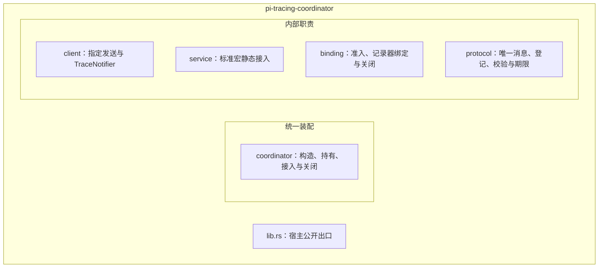

# tracing-coordinator · 模块（L5）

**状态：定向返工后定稿/冻结，2026-10-16。** 用户确认普通类型化静态服务的完整L5提案并进入L7。五模块保留，私有协议准备模型撤回，采用宿主预绑定codec和既有服务宏。这里是预期结构，不是功能验收；本段保留L5确认时结构视角；后续L7五模块设计与源码门禁现已全部确认落地，见[当前接口](../07-design/api.md#api-index)。旧2026-10-15结构与替代原因见[日志](../index/changes.md)。

## 模块清单

| 模块 | 职责与权威状态 | 隐藏的易变决定 |
|---|---|---|
| coordinator | 宿主统一入口；构造并拥有绑定与共享客户端，交付notifier，协调本库静态服务接入、记录器绑定和关闭；在冷路径取得宿主选好层的codec。 | 一个完整协调器如何装配和持有。 |
| protocol | 唯一SelectionMessage、集中Fory类型登记、业务参数转换与校验、期限转换；不拥有codec或业务关联状态。 | 上报消息的表示及合法性规则。 |
| binding | 独占管理准入、一次性可选记录器绑定和关闭状态；接管已校验结果，经准入向记录器发布一次。 | 协调操作的生命周期规则。 |
| client | 弱持宿主终端，复用预绑定codec；向指定Peer提交上报通知，实现现有TraceNotifier，两种调用共用发送路径。 | 宿主已有发送出口的接入方式。 |
| service | 使用现有#[pi_service]生成静态服务；接收类型化参数，调用业务校验及绑定交接，记录业务入口后的拒绝。 | 既有静态服务框架的接入方式。 |

src/lib.rs汇总公开出口。宿主调用的集中类型登记入口由根直接重导出；统一协调器负责日常使用，宿主无需独立配对Binding和Client。具体新名称、签名和最小可见性在L7逐项确认。

## 边界组织图

图定位：本册organization；范围为当前触达的本库预期结构，2026-10-16用户确认版。

**读图说明：** 方框表示归属，没有调用先后含义。绑定状态属于binding；消息表示与合法性属于protocol；两者均不开放裸状态、锁或记录器getter。client与service通过这些窄出口协作，互不持有、互不调用。此图不表示线程、初始化或失败时序；入口、全部关键分支、并发与释放见[调用图及源表](deps.md#calls)、[持有图及源表](deps.md#ownership)。模块节点对应上表；具体符号通过[L7接口索引](../07-design/api.md#api-state)定位，五模块替代声明均已落地，尚无行为证据。

## 切分理由

此次调整让codec生命周期回到宿主既有通信装配中，绑定模块只维护本库操作状态，不再同时承担进程级Fory准备。

| 切分 | 理由及不采用的结构 |
|---|---|
| coordinator统一装配 | 构造、配对、notifier交付与关闭由一个入口收口；不让宿主独立配对Binding/Client，也不把完整装配塞入发送模块。 |
| protocol集中消息规则 | 同一消息表示、登记和合法性影响两端；不在收发端重复定义，不保留旧登记业务枚举或私有codec。 |
| binding封装生命周期 | 一次绑定、发送/接收准入和关闭必须共用权威状态；不导出字段、锁、记录器或升级后门。 |
| client合并显式/notifier发送 | 当前两种调用提交同一种上报消息；不新增独立notifier模块或第二发送路径。 |
| service隔离静态框架接入 | 宏解码/上下文装配与业务状态分别变化；不持client或记录器，不依赖不存在的静态注销。 |

## 边界、验证与下游

- 唯一接收业务是apply_remote_selection；record_peer、关联表、目标选择、附件和通信协议归宿主及对应上游。
- [21条依赖](deps.md#deps)、[调用](deps.md#calls)、[持有](deps.md#ownership)分别描述，不混用编译关系、执行与所有权。
- [变更点及旧L7解冻清单](change-points.md#change-points)限定重对齐范围；[决定和可行性](decisions.md#decisions)记录宿主codec装配、具体宏适配、失败责任及依赖取舍。
- L5仅校验当前触达范围；声明编译只证明引用网自洽，后续实现、TDD与验收仍需真实行为证据。L7已完成11源码/37个独立TODO芯并通过声明check，已经适配本结构；完整实现/行为仍待后续验证。

来源：[需求](../01-requirements/needs.md#needs)、[类型化职责](../01-requirements/notes.md#typed-static-boundary)、[选号归档](../../../docs/FORY_TYPE_ID_ALLOCATION_ARCHIVE_20261016.md#fory-allocation-contract)、[日志](../index/changes.md)。恢复：[索引](../00-index.md)、[当前状态](../../../docs/DEVELOPMENT_CONTEXT.md#ctx-current)。
