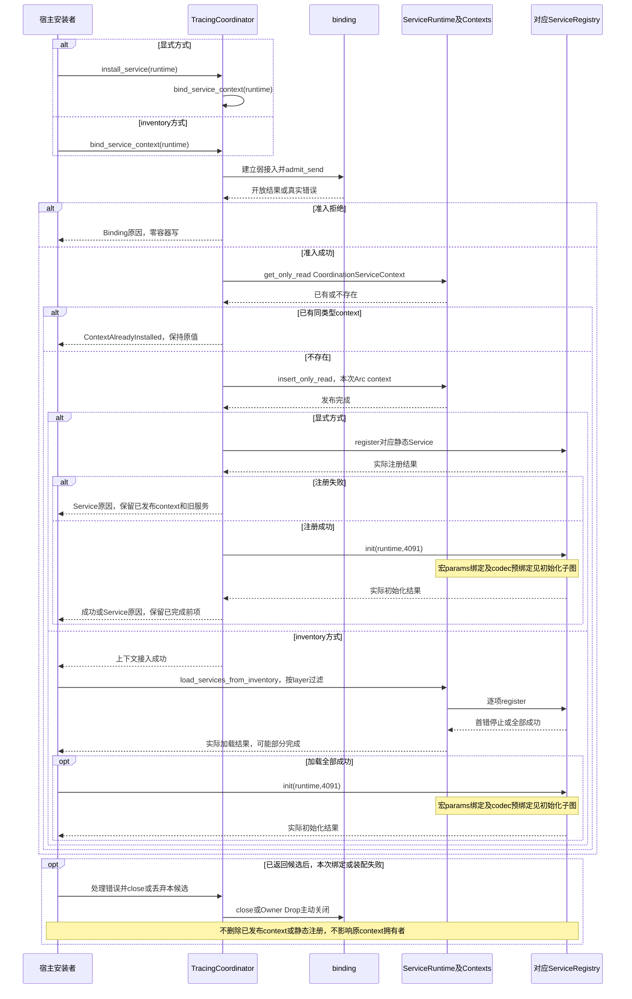
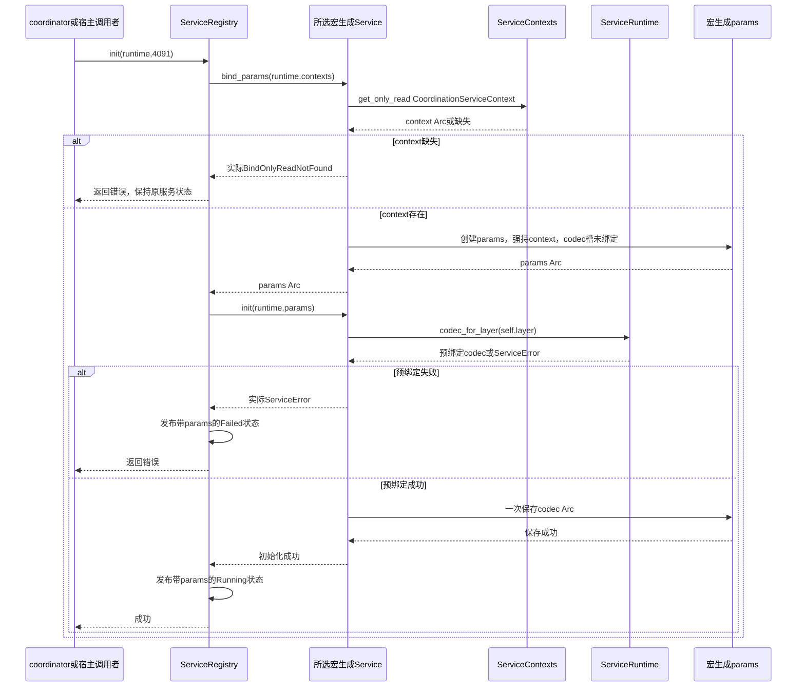
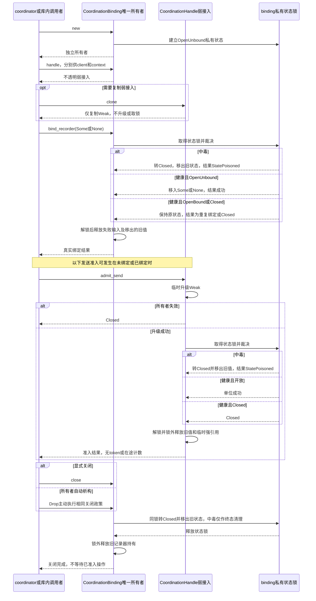
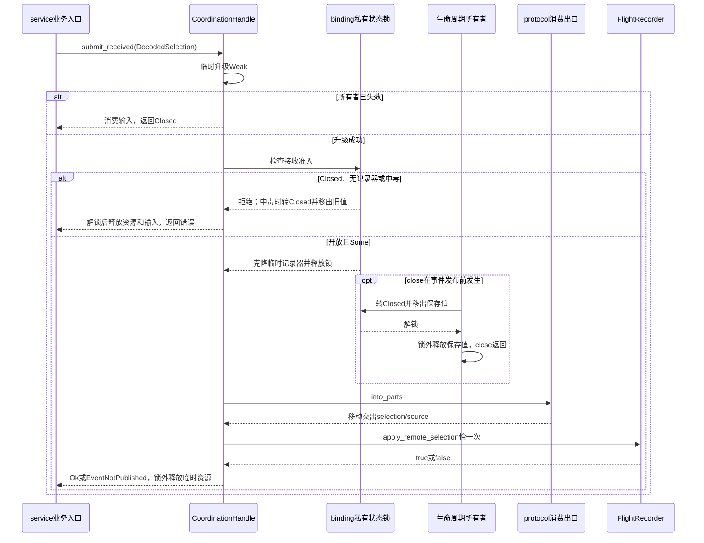
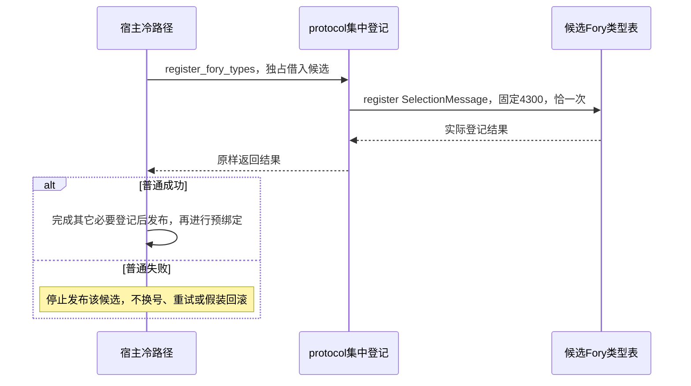
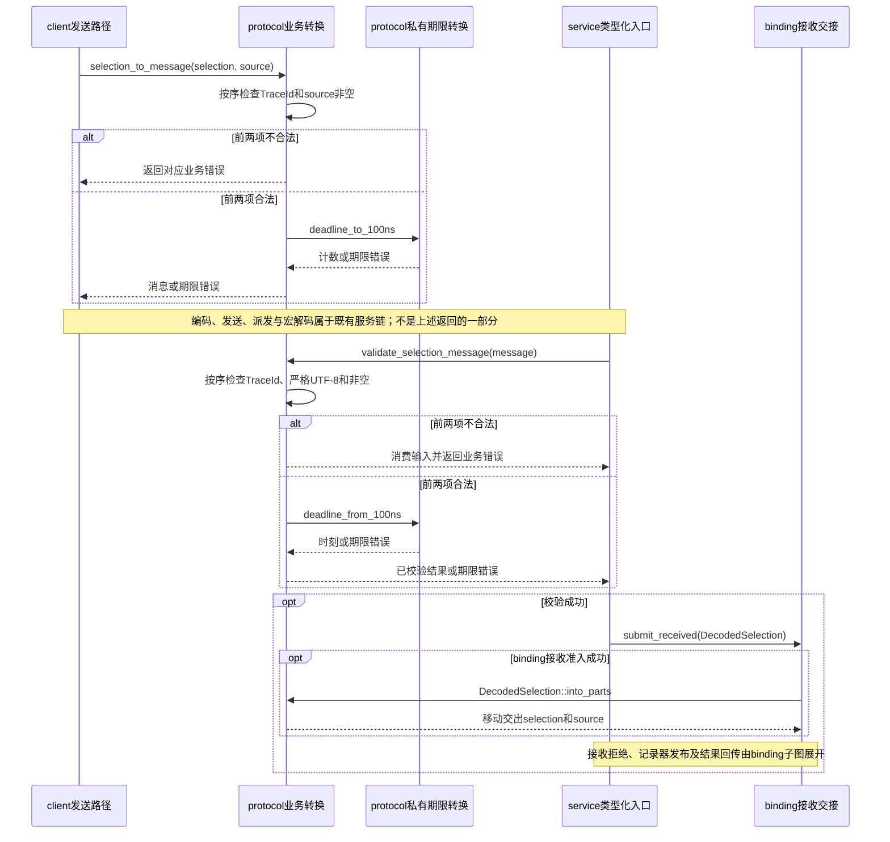
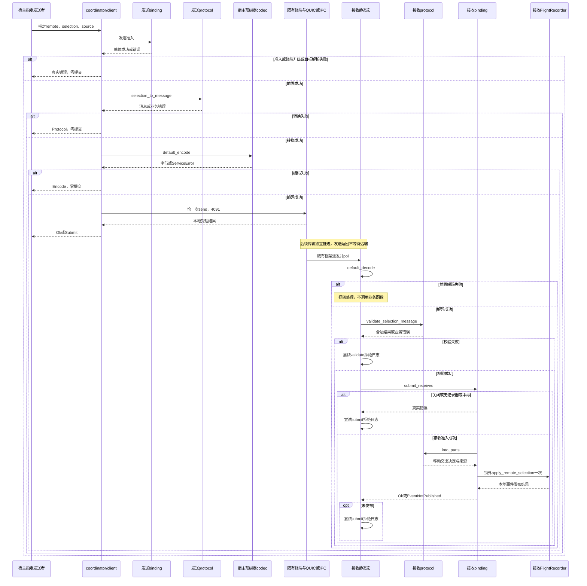

# tracing-coordinator · 预期调用链（L7）

**实施状态更新，2026-10-19：** 五模块37个手写实现入口均已完成，原dev-impl七块流程及各切片独立测试/功能审查已结束。L7技术合同、签名/类型/可见性不变。当前验收限分块已有证据与用户最新允许的WSL检查；后续不执行集成、压力、基准或Windows原生构建测试，不把原完整部署矩阵标为通过。见[实施验收矩阵](../../../docs/IMPLEMENTATION_ACCEPTANCE.md#acceptance-matrix)、[稳定出口摘要与现状图](../../../docs/IMPLEMENTATION_API.md#implementation-api)和[当前控制台](../../../docs/DEVELOPMENT_CONTEXT.md#ctx-current)。历史声明期/TDD失败事实仍按当时状态保留。

<a id="chain-index"></a>
## 目录

- 当前protocol
  - [集中登记冷路径](#chain-protocol-registration)
  - [业务转换与消费交接](#chain-protocol-typed)
- 当前binding
  - [生命周期与发送准入](#chain-binding-lifecycle)
  - [接收与关闭交错](#chain-binding-typed)
- 当前client
  - [理由、符号及边界入口](#chain-client-typed)
- 当前service
  - [框架宏初始化](#chain-service-initialization)
  - [标准宏消息接收](#chain-service-typed)
- 当前coordinator
  - [构造、notifier与一次绑定](#chain-coordinator)
  - [上下文发布与两种安装](#chain-coordinator-install)
- [最终全链与源表](#chain-final)
- [完备有序实现切片](#implementation-slices)
- [接入与下游](#chain-next)
- [历史已替代条目](#chain-history)

<a id="chain-coordinator"></a>
## 统一协调器装配预期链（设计已确认，2026-10-16）

范围：构造、notifier与一次记录器绑定。宿主先沿[集中登记图](#chain-protocol-registration)完成登记、发布并核对真实使用表。

~~~mermaid
sequenceDiagram
    participant H as 宿主冷路径
    participant C as TracingCoordinator
    participant R as 既有ServiceRuntime
    participant B as binding
    participant X as client构造
    participant S as service静态出口及上下文
    participant L as pi_logger初始化

    H->>C: new_default或new_multi_layer
    opt MultiLayerCodec构造
        C->>R: codec().has_layer，检查明确目标层
        R-->>C: 是否存在
    end
    alt 多层目标缺失
        C-->>H: CodecLayerMissing，不继续构造
    else 默认装配或目标层存在
        C->>R: codec_for_layer，冷路径预绑定
        R-->>C: Arc codec或实际ServiceError
        alt 预绑定失败
            C-->>H: Service原因，不发布对象
        else 预绑定成功
            C->>S: 取得对应default_service或multi_layer_service
            S-->>C: 对应静态Service借用
            C->>B: new，并分别取得两个handle
            B-->>C: 唯一owner及client/context弱接入
            C->>X: new，移入codec、弱接入和local，借terminal
            X-->>C: client值
            C->>S: CoordinationServiceContext::new，移入另一弱接入
            S-->>C: context值
            C->>C: Arc共享client/context，按冻结字段组合
            C-->>H: 独立协调器，尚未安装服务
        end
    end

    opt 构造成功且宿主继续logger接入
        H->>C: notifier
        C-->>H: 共享client的既有trait Arc
        H->>L: 注入notifier并初始化
        L-->>H: 记录器或不可用结果，由宿主处理
        H->>C: bind_recorder(Some或明确None)
        C->>B: bind_recorder一次
        B-->>C: 真实绑定结果
        C-->>H: 绑定结果
    end
~~~

| 行为 | 图中节点序列 | 成功/失败出口 |
|---|---|---|
| 具体构造入口 | H → C | 宿主保证terminal/runtime匹配，后续安装使用同一runtime。 |
| 多层前置 | C → R → C | 仅多层先查明确目标层；缺失C → H，返回CodecLayerMissing，不隐式回退。 |
| 冷路径预绑定 | C → R → C | 默认/多层各取对应codec；真实ServiceError返回H，不继续组合。 |
| 静态服务选择 | C → S → C | 取得与具体codec对应的静态服务，不注册或初始化。 |
| 独立状态与弱接入 | C → B → C | 创建唯一binding owner，分别取得两个弱接入。 |
| 客户端构造 | C → X → C | 借terminal建立Weak，移入codec、弱接入及local；不验证或发送。 |
| 上下文构造与组合 | C → S → C；C内部组合 → H | context仅持另一弱接入；Arc共享client/context，binding保持首字段；不发布context。 |
| notifier接入 | H → C → H → L → H | 只共享client；logger初始化归宿主，初始化结果不由本库伪装成就绪。 |
| 一次绑定 | H → C → B → C → H | Some/None均消耗机会；真实BindingError由协调器保存返回。 |

### 标准读图说明

- **范围与图例：** 这是构造及logger接入预期；实线调用、虚线回传。X/S显式承载此前遗漏的client/context构造。
- **主路径：** 宿主完成真实表准备后，按具体codec构造；多层先判缺层，再预绑定、选择static、创建binding/两个弱接入、组合client/context，最后返回。
- **失败出口：** 缺层或预绑定错误停止后续；普通构造失败没有已返回协调器，只释放局部持有，不虚构一次close。分配或依赖panic不冒充普通Err。
- **并发与推进：** 冷路径由宿主推进，同步无新增任务；构造不取得binding状态锁。使用期配置稳定，不作热路径登记检查。
- **资源与状态：** 不保存runtime或终端强引用，不注册/初始化服务；notifier只保活client/codec。构造成功不代表记录器或通信就绪。
- **限制：** 默认共享槽与多层快照差异沿壳合同；相同泛型不能证明环境配对，预绑定成功不能独自证明真实类型登记。
- **定位与验证：** 对应[coordinator.rs](../../../src/coordinator.rs)两构造、notifier、bind_recorder，以及binding/client/service现有出口。真实装配与释放的分块证据见[coordinator验收](../../../docs/IMPLEMENTATION_ACCEPTANCE.md#acceptance-coordinator)。

<a id="chain-coordinator-install"></a>
## 上下文发布与两种安装方式（差量确认，2026-10-16）

图定位：chain-coordinator-install。显式与inventory方式择一；同一逻辑服务的安装、容器修改和关闭由宿主串行化。



| 行为 | 图中节点序列 | 成功/失败出口 |
|---|---|---|
| 方式入口 | H → C；显式时C内部调用绑定入口 | 两种方式共用bind_service_context；不重复注册。 |
| 开放准入 | C → B → C | 失败C → H，零容器写；返回时已释放binding锁。 |
| 查询上下文 | C → R → C | 已有即拒绝，同Arc也不幂等；保持原值和原拥有者。 |
| 发布本次上下文 | C → R → C | 在宿主串行前提下，不存在才插入本次Arc；不保证抗任意并发替换。 |
| 显式注册 | C → G → C | 冲突返回真实ServiceError，不覆盖、换号或撤销context。 |
| 显式初始化 | C → G → C → H | 仅注册成功才init；返回真实结果，部分完成状态由框架保留。 |
| inventory加载 | C → H → R → G → R → H | 接入成功才按layer加载；逐项注册首错停止，已完成项不回滚。 |
| inventory初始化 | H → G → H | 仅加载成功才初始化4091，宿主直接处理结果。 |
| 候选失败收尾 | H → C → B | 针对已返回的本次候选关闭/丢弃；不删除框架前项或关闭共享设施。 |

### 标准读图说明

- **范围与图例：** 覆盖上下文发布和安装编排；G内部init另见[初始化子图](#chain-service-initialization)。实线调用、虚线结果，不把数据返回当反向调用。
- **主路径：** 先开放准入，再查上下文，不存在才发布；随后显式register→init，或宿主inventory load→init。
- **失败出口：** 首错停止后续；预占context保持原值；发布后的注册/初始化失败不回滚。构造失败无对象的情况不进入本图收尾。
- **并发与推进：** 宿主串行前提不可省略；不持binding锁进入contexts/registry。依赖可同步持锁、复制表或调用监听器，监听器不得重入注册/初始化。
- **资源与状态：** 已发布context可保留弱接入；close不删除context/static/params，也不清codec/TLS。已有context的拒绝不影响其原拥有者。
- **限制：** 安装不是事务；Running不代表记录器或远端就绪，也不是所有registry的端口全局唯一证明。
- **定位与验证：** 对应[bind_service_context、install_service](../../../src/coordinator.rs)和已核load_services_from_inventory/registry出口；重复context、冲突和部分失败证据见[coordinator验收](../../../docs/IMPLEMENTATION_ACCEPTANCE.md#acceptance-coordinator)。

<a id="chain-service-initialization"></a>
## 框架宏初始化（差量确认，2026-10-16）

图定位：chain-service-initialization。此图表达合法registry装配：由同一静态服务创建params，再交给该服务初始化。



| 行为 | 图中节点序列 | 成功/失败出口 |
|---|---|---|
| 初始化入口 | A → G → S | registry调用对应static的bind_params，不是创建协调器时完成。 |
| 上下文提取 | S → X → S | 缺失返回真实BindOnlyReadNotFound；G → A返回，保持框架旧状态。 |
| params创建 | S → P → S → G | params强持context，codec槽初始未绑定；不强持binding owner。 |
| 宏预绑定 | G → S → R → S | 合法params来自同服务；调用codec_for_layer取得接收codec。 |
| 宏初始化失败 | S → G；G内部发布 → A | Service init错误才发布Failed，保存params；不能与bind_params失败混同。 |
| 宏初始化成功 | S → P → S → G；G内部发布 → A | 保存codec后Running；仅本runtime初始化完成。 |

### 标准读图说明

- **范围与前提：** 聚焦合法registry/宏装配；注册不存在等registry前置错误仍沿实际框架返回。手工伪造params的downcast/重复初始化防御不作为这条生产主路径。
- **图例与主路径：** 实线调用、虚线回传；先bind_params，再Service init，最后registry发布状态。
- **失败出口：** 缺上下文在bind_params阶段返回，旧状态保持；codec预绑定错误发生在Service init阶段，才发布Failed。依赖panic不画成普通错误。
- **并发与推进：** 冷路径同步执行；registry锁及同步监听由框架负责，本库不在外层持binding锁。无Future等待或新增任务。
- **资源与状态：** params强持context和预绑定codec；context弱持binding。Failed/Running条目均可能延长params生命周期。
- **限制：** 服务元信息和预绑定不证明类型表正确登记；Running不代表业务就绪。使用期配置稳定，两个codec适配每进程择一。
- **定位与验证：** 对应已核ServiceRegistry::init、宏生成的bind_params/init；本库定位到[service.rs](../../../src/service.rs)两个宏适配及静态getter。真实初始化与状态证据见[service验收](../../../docs/IMPLEMENTATION_ACCEPTANCE.md#acceptance-service)。

<a id="chain-service-typed"></a>
## 类型化接入第四批：标准宏接收预期链（设计已确认，2026-10-16）

~~~mermaid
sequenceDiagram
    participant F as 既有静态服务框架
    participant K as 宏params预绑定codec
    participant S as typed业务入口
    participant P as protocol校验与消费
    participant B as binding交接
    participant R as FlightRecorder
    participant O as 宿主日志接收者

    F->>K: poll时default_decode
    K-->>F: SelectionMessage或错误
    alt 解码失败
        Note over F: 不调用业务函数，沿框架处理
    else 解码成功
        F->>S: context、拥有式message
        S->>P: validate_selection_message
        P-->>S: 合法结果或业务错误
        alt 校验失败
            S->>O: 尝试一次validate警告
        else 校验成功
            S->>B: submit_received一次
            alt 准入拒绝
                B-->>S: 真实BindingError
                S->>O: 尝试一次submit警告
            else 准入成功
                B->>P: 锁外into_parts
                P-->>B: 移动交出selection/source
                B->>R: 锁外apply_remote_selection一次
                R-->>B: 本地事件发布结果
                B-->>S: Ok或EventNotPublished
                opt 事件未发布
                    S->>O: 尝试一次submit警告
                end
            end
        end
        S-->>F: 单位返回
    end
~~~

| 行为 | 图中节点序列 | 成功/失败出口 |
|---|---|---|
| 前置解码 | F → K → F | 实际poll时解码；失败由框架处理，不进入S，也不承诺本库日志。 |
| 类型化入口 | F → S | 解码成功才把拥有式消息和上下文借用交给对应适配；适配纯委托共同处理芯。 |
| 业务校验 | S → P → S | 失败不进入binding/记录器，尝试一次validate日志。 |
| 交接与拒绝 | S → B；拒绝B → S → O | 校验成功才交接一次；真实准入错误返回后尝试一次submit日志。 |
| 合法结果消费 | B → P → B | 准入成功后锁外into_parts，不重复校验。 |
| 本地事件发布 | B → R → B → S | 锁外调用记录器一次；成功仅本地事件发布，false返回EventNotPublished。 |
| 未发布观测 | S → O | 仅未发布时尝试一次submit日志，不猜原因、不重试。 |
| 业务返回 | S → F | typed返回单位，无远端应答；消息被消费，不保存待处理输入。 |

### 标准读图说明

- **目的与前提：** 表达运行期接收；宏params已完成冷路径绑定。对应装配见[协调器构造](#chain-coordinator)、[安装编排](#chain-coordinator-install)及[框架宏初始化](#chain-service-initialization)。
- **图例：** 实线调用，虚线结果。S合并两个具体codec适配及共同处理芯；P的校验和消费职责仍属于protocol。
- **主路径：** 框架实际poll→解码→typed→完整业务校验→binding准入→锁外消费→一次记录器发布。
- **分支与出口：** 解码失败不进typed；业务非法不进binding；准入拒绝不调用记录器；未发布只报告真实分类。typed后拒绝才尝试本库分阶段日志。
- **并发与推进：** 创建Future不代表已解码；typed业务同步执行。日志在binding返回、其锁和临时资源释放后执行，不参与状态推进。
- **资源：** params强持context/codec，context只弱持binding。消息成功失败均消费；关闭不清params或codec。
- **限制：** 已准入可在close后收尾；不证明任意异常Fory输入安全、日志落盘、传播或导出完成。
- **定位与验证：** [receive_selection_default/receive_selection_multi_layer](../../../src/service.rs)→[service_inner::receive_selection](../../../src/service_inner.rs)，再到protocol/binding出口；真实宏装配和实际poll分块证据已归档于[service验收](../../../docs/IMPLEMENTATION_ACCEPTANCE.md#acceptance-service)。

<a id="chain-client-typed"></a>
## 类型化接入第三批：客户端预期发送（设计已确认，2026-10-16）

~~~mermaid
sequenceDiagram
    participant H as 显式调用者
    participant L as 既有通知线程
    participant C as client发送接入
    participant B as binding准入
    participant P as protocol业务转换
    participant K as 已预绑定宿主codec
    participant T as 宿主终端

    alt 显式发送
        H->>C: send_selection(remote, selection, source)
    else notifier
        L->>C: notify(remote, selection)
        C->>C: 保存local作source，调用同一send_selection一次
    end
    C->>B: admit_send
    B-->>C: 解锁后单位成功或错误
    alt 准入拒绝
        Note over C: Binding，零提交
    else 准入成功
        C->>C: 升级终端并解析目标
        alt 终端失效或目标非法
            Note over C: 对应错误，零提交
        else 目标合法
            C->>P: selection_to_message
            P-->>C: 拥有消息或业务错误
            alt 转换失败
                Note over C: Protocol，零提交
            else 转换成功
                C->>K: default_encode
                K-->>C: 拥有字节或ServiceError
                alt 编码失败
                    Note over C: Encode，零提交
                else 编码成功
                    C->>T: 恰一次send，4091，from=None
                    T-->>C: 本地受理结果或ServiceError
                end
            end
        end
        C->>C: 锁外释放临时终端及局部资源
    end
    alt 显式发送
        C-->>H: Result，调用者处理
    else notifier
        opt 普通失败
            C->>C: 尝试一次警告并接管同一错误
        end
        C-->>L: anyhow::Result
    end
~~~

| 行为 | 图中节点序列 | 成功/失败出口 |
|---|---|---|
| 显式/notifier入口 | H → C，或L → C后C内部委托 | 分别使用本次source/保存local；notifier只委托一次同一发送路径。 |
| 发送准入 | C → B → C | 拒绝返回Binding，零提交；成功返回前已解锁，不交令牌。 |
| 终端与目标 | C内部升级、解析 | 先终端失效、后目标非法；任一失败零提交，不继续转换。 |
| 业务转换 | C → P → C | 成功取得拥有式消息；失败Protocol，零提交。 |
| 宿主编码 | C → K → C | 只借保存的codec；失败Encode，零提交。 |
| 唯一提交 | C → T → C | 4091、拥有字节、from=None；结果仅本地受理或Submit，不重试。 |
| 资源收尾 | C内部锁外释放 | 取得临时终端后，各成功/失败出口均释放本次持有及局部值。 |
| 结果与观测 | C → H，或C内部日志后C → L | 显式直接返回；notifier普通失败在临时终端释放后尝试一次日志，再接管同一错误。 |

### 标准读图说明

- **目的与前提：** 展开发送，不包含客户端构造。冷路径组合见[协调器图](#chain-coordinator)；宿主已完成真实类型表登记、发布及匹配环境装配。
- **图例：** 实线主动调用，虚线数据返回。C合并客户端入口及其芯；自调用表示同模块委托或局部动作，不增加模块反向边。
- **主路径：** 两种入口汇合后，依次准入、终端升级、目标解析、业务转换、编码、唯一提交。
- **分支与出口：** 全部前置失败零提交；Submit不证明外部零效果。显式与notifier只在来源选择和失败观测上按既有合同区分。
- **并发与推进：** 当前线程同步执行，无新Future/任务；传输由宿主独立推进。准入后关闭不撤销本次操作。
- **资源：** codec由client强持，终端仅本次临时强持；释放不持binding锁。最后强引用析构的阻塞/panic成本仍存在。
- **限制：** Ok不证明远端处理；日志只保证尝试，实际记录受宿主控制。图不证明TLS回收、全宿主无环或零分配。
- **定位与验证：** [client.rs](../../../src/client.rs)的new在冷路径图定位；本图定位send_selection、TraceNotifier::notify及[同名芯](../../../src/client_inner.rs)。错误trait与验证归属在切片批次收束；行为及独立审查见[client验收](../../../docs/IMPLEMENTATION_ACCEPTANCE.md#acceptance-client)。

完整有序切片见本册末轮当前条目；旧切片不恢复私有准备。客户端替代声明已落并通过前后WSL检查；图继续表达冻结合同，实际运行及独立审查证据另见本册顶部矩阵。

<a id="chain-binding-lifecycle"></a>
## binding生命周期与发送准入（差量确认，2026-10-16）

图定位：chain-binding-lifecycle。范围：既有CoordinationBinding/CoordinationHandle的创建、一次绑定、弱接入、发送准入与关闭。图分段展示不同操作；发送不要求先绑定记录器。



| 行为 | 图中节点序列 | 成功/失败出口 |
|---|---|---|
| 创建 | C → O → M；O → C | new建立独立OpenUnbound，不绑定记录器或准备协议资源。 |
| 建立/复制弱接入 | C → O → C；可选C → H → C | handle/Clone只建立或复制Weak，不升级、取锁或消耗绑定机会。 |
| 一次绑定 | C → O → M → O → C | 首次Some/None均消耗机会；健康锁下Closed优先于重复绑定，旧值不被替换。 |
| 绑定清理 | O内部锁外释放 | 中毒转终态后返回StatePoisoned；失败输入及旧持有锁外释放，不返还输入。 |
| 发送弱升级 | C → H；H内部升级 | 失效直接Closed；成功仅临时保活私有状态。 |
| 发送状态裁决 | H → M → H → C | 开放状态均可发送；关闭拒绝；中毒终态清理并返回StatePoisoned。返回前解锁、释放临时强引用，不交令牌。 |
| 关闭/Owner Drop | C → O → M → O → C | 主动转Closed、移出旧值、解锁后释放；重复关闭保持终态，不等待在途，不清除中毒。 |

### 标准读图说明

- **目的、范围与前提：** 补齐原接收图未覆盖的生命周期及发送准入；各分段是独立操作，不表示必须“绑定后才能发送”。
- **节点、连线与图例：** C是合法库内调用者，O是唯一所有者，H是不透明弱句柄，M是私有状态锁。实线调用、虚线返回；锁和原始状态不交给C。
- **入口与主路径：** 构造建立状态，handle提供弱接入；宿主经协调器绑定一次。每次发送准入独立升级、同锁裁决并在返回前释放临时资源。
- **分支与出口：** Some/None同样消耗机会；重复不替换；关闭不重开。中毒只作终态清理，有结果方法仍返回StatePoisoned。
- **并发、同步与推进：** 全部同步，无新增任务。绑定、准入和关闭由同一把锁裁决；可能等待锁，不保证公平或固定等待时间。
- **状态与资源生命周期：** 所有者Drop主动关闭，不等待临时Arc消失。记录器持有和失败输入均锁外释放；Weak不永久保活所有者。
- **成立条件与限制：** 准入是一次裁决，不能撤销已获准操作；关闭不是副作用屏障，也不关闭宿主terminal、runtime、Guard或清理codec/TLS。
- **定位与验证：** 对应[binding.rs](../../../src/binding.rs)的new、handle、Clone、bind_recorder、admit_send、close、Drop及[各自芯](../../../src/binding_inner.rs)；后续验证见[binding验证](errors.md#errors-binding-typed)。当前十芯均已实现，见[binding验收及内部属性审查](../../../docs/IMPLEMENTATION_ACCEPTANCE.md#acceptance-binding)。

<a id="chain-binding-typed"></a>
## binding接收与关闭交错（差量确认，2026-10-16）

图定位：chain-binding-typed；当前binding去资源合同，用户完整门禁确认版；冻结时序，分块行为与独立源码证据见实施验收，不把图本身当运行证明。



| 行为 | 图中节点序列 | 成功/失败出口 |
|---|---|---|
| 接收入口与弱升级 | S → H；H内部升级 | 接管DecodedSelection；失效时消费输入并返回Closed。 |
| 接收拒绝 | H → M → H → S | 关闭、无记录器或中毒拒绝，锁外清理，零记录器调用；中毒只作终态清理。 |
| 接收获准 | H → M → H | 开放且Some时锁内克隆临时记录器并解锁。 |
| 获准后的关闭交错 | O → M → O；O锁外释放 | close可先返回，已准入操作仍持有临时记录器并允许收尾。 |
| 消费合法结果 | H → P → H | 获准后锁外into_parts，移动取出selection/source。 |
| 发布与返回 | H → R → H → S | 锁外调用一次记录器；true → Ok，false → EventNotPublished，不猜原因或重试；临时资源锁外释放。 |

### 标准读图说明

- **目的/范围/前提：** 展开已校验接收输入与关闭的竞争。创建、一次绑定、弱接入复制及发送准入分别见[生命周期图](#chain-binding-lifecycle)，不再混入本图源表。输入由protocol完整校验；当前实现及分块验收已完成。
- **节点/连线/主路径：** S是接收业务调用者，H是受限弱句柄，M为binding私有Mutex，O为唯一Owner，P为protocol消费出口，R为记录器。实线主动调用、虚线数据回传；锁不向S开放。H临时升级、同锁准入、解锁后拆解并一次发布。
- **全部重要分支/出口：** Weak失效Closed；关闭、无记录器及中毒拒绝；中毒移出旧值后锁外释放。开放且Some才准入；记录器true→Ok/false→EventNotPublished，不猜原因或重试。输入成功失败均消费，无返回缓冲。
- **并发/推进：** 当前线程同步执行，无Future等待/新任务。关闭先同锁转终态则后续拒绝；准入先则临时副本可在close返回后继续提交/发布。Mutex可能阻塞，无公平/固定等待保证。
- **状态/资源：** 状态/记录器归binding；锁内仅裁决、移动和Arc克隆，记录器调用/日志/析构都锁外。Owner Drop主动关闭，不等临时Arc消失；close不等待在途或关闭共享终端/runtime/Guard。
- **成立条件/限制：** 接收成功仅本地事件发布，后续worker/通知线程独立，不是当前栈反调client。client/宏params codec不由binding关闭清理；图不证明整个宿主无环、全局副作用屏障或跨线程清TLS。状态工作O(1)，锁/依赖执行/析构另计。
- **直白示例：** 如停止接新单，已受理工作仍可收尾；真实对应状态锁转Closed及临时引用继续存活。类比不代表网络撤回、等待清空或所有资源立即销毁。
- **定位/验证：** 新接口见[本批接口](api.md#api-binding-typed)，表示见[数据](data.md#data-binding-typed)，十芯预期见[单元](units.md#units-binding-typed)，后续必要证据见[错误册](errors.md#errors-binding-typed)。原2026-10-16 protocol/binding声明通过指定WSL check；当前protocol第1块已有定向行为证据，binding十芯及其行为/内部属性独立审查均已完成。

反向：[L5调用/持有](../05-modules/deps.md#ownership)、[源码迁移范围](api.md#api-binding-typed)、[当前状态](../../../docs/DEVELOPMENT_CONTEXT.md#ctx-current)。

<a id="chain-protocol-registration"></a>
## protocol集中登记冷路径（差量确认，2026-10-16）

图定位：chain-protocol-registration。范围：宿主独占候选类型表的一次集中登记，以及随后是否发布的决定。候选可以已有其它库类型，但尚未发布或用于编解码。



| 行为 | 图中节点序列 | 成功/失败出口 |
|---|---|---|
| 集中登记入口 | H → P | register_fory_types只借用宿主独占候选，不保存借用。 |
| 唯一底层登记 | P → F → P | 只登记SelectionMessage=4300一次，取得实际结果。 |
| 结果回传 | P → H | 原样返回Result<(), fory::Error>，不包装成服务错误。 |
| 发布决定 | H → H，或H停止发布 | 成功后由宿主完成必要登记并发布；失败不发布，不宣称候选保持原样。 |

### 标准读图说明

- **目的、范围与前提：** 单独表达登记冷路径；不与每次消息转换混在一起。候选表的独占、未发布及未用于编解码由宿主保证。
- **节点、连线与图例：** H是宿主，P是本库登记入口，F是宿主候选表。实线是调用，虚线是结果回传；P不反调宿主。
- **入口与主路径：** 宿主借入候选，本库执行一次固定编号登记并返回；只有宿主完成全部必要登记后才发布和预绑定。
- **分支与出口：** 普通错误原样返回，宿主停止发布；不探号、换号、重试或回滚。依赖panic/分配终止不属于图中的普通错误分支。
- **并发、同步与推进：** 当前线程同步执行，无本库任务或状态锁；不与候选表编解码并发使用。
- **状态与资源生命周期：** 表归宿主；本库不保存表、codec或借用。失败候选的处置归宿主。
- **成立条件与限制：** 成功只证明本次登记成功，不证明真实使用表、服务初始化或通信成功。普通Result语义还受实际FORY_PANIC_ON_ERROR构建开关约束。
- **定位与验证：** 对应[protocol.rs](../../../src/protocol.rs)的register_fory_types、[protocol_inner.rs](../../../src/protocol_inner.rs)同名芯及[protocol验证](errors.md#errors-protocol-typed)。集中登记实现与行为证据见[登记验收](../../../docs/IMPLEMENTATION_ACCEPTANCE.md#acceptance-registration)。

<a id="chain-protocol-typed"></a>
## protocol业务转换与消费交接（差量确认，2026-10-16）

图定位：chain-protocol-typed。范围：发送转换、宏解码成功后的业务校验，以及binding获准后的消费出口。集中登记见[独立图](#chain-protocol-registration)；编码、传输和记录器发布由各自子图展开。



| 行为 | 图中节点序列 | 成功/失败出口 |
|---|---|---|
| 发送身份校验 | C → P；P内部按序检查 | TraceId或source非法，P → C返回首个业务错误，不进入期限转换。 |
| 发送期限转换 | P → D → P → C | 合法才调用deadline_to_100ns；成功交出拥有式消息，失败准确返回期限错误。 |
| 两段业务之间的边界 | C、S之间的说明 | 编码、发送、派发和前置解码不属于protocol转换返回的一部分；不能把两段视为一次事务。 |
| 接收身份校验 | S → P；P内部按序检查 | 消费消息，依次检查TraceId、严格UTF-8/非空；失败P → S，不进入期限转换或binding。 |
| 接收期限转换 | P → D → P → S | 身份合法才调用deadline_from_100ns；全部通过才交出DecodedSelection。 |
| 合法结果交接 | S → B | 仅校验成功才调用submit_received；准入仍由binding裁决。 |
| 获准后消费 | B → P → B | 仅接收准入成功才锁外调用into_parts，移动交出selection/source；拒绝路径不调用。 |

### 标准读图说明

- **目的、范围与前提：** 展开纯业务转换和合法结果消费，不表达完整传输链。接收入口的消息已由标准宏解码，但尚未取得业务合法性。
- **节点、连线与图例：** C/S是调用方，P/D属于protocol，B属于binding。实线是调用，虚线是数据返回；不存在protocol反调client或service。
- **入口与主路径：** 发送先校验身份再转换期限；接收先完整校验再构造交接结果；binding获准后才消费into_parts。
- **分支与出口：** 身份失败停止期限转换，期限失败准确分类；接收校验失败不进入binding。binding拒绝不会调用into_parts，其详细错误和发布结果见[binding子图](#chain-binding-typed)。
- **并发、同步与推进：** protocol在当前线程同步执行，不取状态锁、不创建Future或任务。宏的Future必须由框架实际poll，创建Future不代表已解码。
- **状态与资源生命周期：** 消息及交接结果只保存业务数据；借入source不被保存，接收输入成功失败均被消费。binding的锁与临时引用由其自身管理。
- **成立条件与限制：** 不读取当前时间、不续期，也不复制记录器的时效或去重策略；不证明远端完成、任意异常Fory输入安全或硬内存上限。转换成本及失败状态以壳合同为准。
- **定位与验证：** 对应[protocol.rs](../../../src/protocol.rs)的两种业务转换、两种期限转换、DecodedSelection::into_parts，以及[各自同名芯](../../../src/protocol_inner.rs)；验证入口为[protocol验证](errors.md#errors-protocol-typed)。本块7芯已有[定向行为证据](../../../docs/SLICE_PROTOCOL_ACCEPTANCE.md#slice-protocol-matrix)及[摘要/图](../../../docs/SLICE_PROTOCOL_API.md#slice-protocol-api)，其余30芯亦已实现；完整消费者装配的分块证据见[实施矩阵](../../../docs/IMPLEMENTATION_ACCEPTANCE.md#acceptance-matrix)，不扩展为全部署矩阵。

### 本批进入最终切片的内容

集中登记、业务转换、消费交接、期限及错误trait均已完成原设计与声明门禁。本轮只补齐图源表达；逐符号唯一验证归属在本轮切片批次收束。现有接口、消息表示和失败语义继续沿用，不恢复旧私有准备模型。

关联：[L5调用/持有](../05-modules/deps.md#calls)、[影响面](../05-modules/change-points.md#l7-revision)、[索引](../00-index.md)、[当前状态](../../../docs/DEVELOPMENT_CONTEXT.md#ctx-current)。

<a id="chain-state"></a>
## 当前图谱状态

五模块图及末轮总链均是已确认设计合同图；当前37芯已实现，现状大纲及实际证据见[实施摘要](../../../docs/IMPLEMENTATION_API.md#implementation-outline)。组织/类型依赖/强弱持有视角见[L5](../05-modules/deps.md#deps)；跨模块全部声明已落，旧准备及旧codec模型不参与当前图谱。

<a id="chain-final"></a>
## 最终完整业务闭环（定稿/冻结，2026-10-16）

图定位：chain-final；范围为两个参与进程之间的一次指定上报。L7总门禁已确认，以下是实现预期，不是运行证据。集中登记及宿主装配先沿[协调器图](#chain-coordinator)完成；类型依赖及强弱持有分别见[L5](../05-modules/deps.md#deps)。



### 全链源表

| 全链源路径 | 图中调用与回传 | 关键出口与边界 |
|---|---|---|
| 指定输入 | H→C | 显式本次source；notifier以保存local汇入同一client路径，细分见客户端图。 |
| 发送前置 | C→B→C；前置失败C→H | binding→终端升级→目标解析，依次裁决，失败零提交。终端升级/解析是C内部动作。 |
| 业务转换 | C→P→C；转换失败C→H | selection_to_message；protocol只做业务转换，失败Protocol。 |
| 宿主编码 | C→K→C；编码失败C→H | codec.default_encode；失败Encode，零提交。 |
| 提交与返回 | C→T→C→H | 唯一send；返回Ok/Submit只表示本地提交结果。 |
| 远端推进 | T→F | 宿主传输及框架poll独立，不承诺发送返回和接收先后。 |
| 前置解码 | F→F | 宏default_decode；失败框架处理，不进业务函数。 |
| 业务校验 | F→Q→F；失败F→F日志 | validate_selection_message完整校验，失败零记录器调用。 |
| 接收交接拒绝 | F→R→F；失败F→F日志 | 同锁准入；关闭/无记录器/中毒按真实错误结束，不发布。 |
| 合法结果消费 | R→Q→R | 准入成功后锁外into_parts，移动selection/source。 |
| 本地发布与结果 | R→L→R→F；未发布F→F日志 | 恰一次apply_remote_selection；true/false仅本地事件发布结果，无远端应答。 |

### 标准读图说明

- **目的、范围与前提：** 串起指定发送、本地受理、框架实际poll、业务校验与记录器交接。前提是宿主已登记/发布真实类型表并完成对应codec和服务装配；关闭单独由[binding时序](#chain-binding-typed)裁决，不画成发送应答。
- **节点与图例：** 实线主动调用、虚线结果数据回传。C合并只做一次委托的协调器和客户端；F合并标准宏与其typed入口/日志，准确模块分界见[接收子图](#chain-service-typed)。左右protocol/binding是不同进程的同类模块，不能把数据返回画成反向调用。
- **入口与主路径：** H给定目标、决定及source，C依次准入、升级、解析、转换、编码并唯一提交。既有传输独立推进；接收宏实际被poll后解码，成功才校验，合法才交binding，获准才移动结果并一次发布。
- **分支与出口：** 全部前置错误停止后续、零提交；提交失败不能推定外部零效果。解码失败不进入业务，业务校验失败不进binding/记录器，准入失败不发布。未发布只记真实EventNotPublished并尝试一次日志，不猜唯一原因、不重试。typed返回单位，无远端确认。
- **并发、同步与推进：** 图在终端返回后再画派发只是区分两个阶段，不保证实际接收一定晚于发送方法返回。发送/typed业务同步，无本库新增Future、线程或任务；框架Future由宿主poll，不把Pending画成占有worker。binding锁只裁决状态，不覆盖编码、日志、记录器或析构；关闭先行拒绝，准入先行允许在close返回后收尾，无第二检查。
- **状态与资源：** 字节移交终端，接收消息消费后不缓存；notifier、params、codec、宿主线程/TLS分别按既定所有权释放。临时终端/记录器引用锁外释放；最后强引用析构仍可能阻塞或panic。关闭不注销服务、不停runtime/终端/Guard、不驱逐TLS。
- **成立条件与限制：** 一次本库提交不是跨调用exactly-once；发送Ok不证明远端处理，记录器true不证明传播/导出。图不承诺全宿主无环、任意异常解码安全、硬容量或日志持久化。成本沿各壳，不能据图声称零分配/零等待。
- **定位与验证：** [五模块接口](api.md#api-index)、[37芯](units.md#units-index)、[错误与资源](errors.md#errors-final)双向定位到真实壳/芯；对应下方切片。全链装配已有第6/7块适用场景证据；原完整部署矩阵仍未闭合，按最新用户执行范围排除，不把局部证据扩大为全矩阵通过。

<a id="implementation-slices"></a>
## 完备有序实现切片

序号是实施顺序，不是任务票。实现阶段每块先满足AGENTS.md的冻结、TDD、必要相关测试、审查和验收，再进入依赖块。2026-10-16本轮只交付设计输入，未执行测试；2026-10-17第1块实施证据见下节。

| 顺序 | 行为块 | 前置 | 本块退出目标 |
|---|---|---|---|
| 1 | 期限、身份及合法消息隔离带，7芯 | 无 | 证明规范化、合法域、字段保真、错误优先级与合法结果消费。 |
| 2 | 唯一集中登记，1芯 | 第1块的消息表示 | 用真实Fory/两种宿主codec证明固定登记、共表、冲突及表示往返；此处不依赖尚未实现的服务宏接收。 |
| 3 | 一次绑定、准入、关闭及释放，10芯 | 第1块的合法交接 | 完成状态、错误、弱生命周期、锁外释放及有界关闭竞争验证。 |
| 4 | 指定目标一次发送与notifier，5芯 | 第1—3块 | 证明六阶段错误顺序、前置零提交、唯一提交、来源和失败观测。 |
| 5 | 标准宏真实接收，4芯＋两个适配 | 第1—3块 | 证明两种适配的元信息、真实宏初始化/poll、非法拒绝、一次交接及params生命周期。 |
| 6 | 统一构造与双安装闭环，10芯＋根出口 | 第2—5块 | 经公开协调器及真实依赖证明构造、显式/inventory安装、部分失败、薄委托和共享环境保护。 |
| 7 | 当前交付集中最终验证，无新芯 | 前六块全部实现、相关验证与审查通过 | 按冻结平台/配置集中完成整体回归、必要压力/基准及最终验收。基准仍服从用户提交时机。 |

**归属规则：** 下列每行只有一个负责块。后续组合测试会再次经过下层出口，但属于消费/复验，不改变该出口的首次验证责任。纯组合或一行委托通过有意义的行为场景保护，不另写赋值镜像测试。每块仍遵守仓库逐层冻结、TDD、必要相关测试、审查与验收；完整回归、压力和基准统一留第7块。

全部需求来源：[需求与验收](../01-requirements/needs.md#needs)；错误册反向定位[唯一验证落点](errors.md#errors-verification-ownership)。壳、签名、类型声明及设计产物已冻结；实现者只进入芯，要改变冻结面须显式解冻并经门禁重新落地。

<a id="slice-protocol"></a>
### 第1块：protocol业务与期限

壳：[src/protocol.rs](../../../src/protocol.rs)；芯：[src/protocol_inner.rs](../../../src/protocol_inner.rs)。前置：无。2026-10-17本块实现、TDD及独立审查已完成；[验收矩阵](../../../docs/SLICE_PROTOCOL_ACCEPTANCE.md#slice-protocol-matrix)、[出口摘要](../../../docs/SLICE_PROTOCOL_API.md#slice-protocol-api)、[现状三图](../../../docs/SLICE_PROTOCOL_API.md#sp-organization)。验证来源为[传输保真、非法输入和职责边界需求](../01-requirements/needs.md#needs)。

| 壳符号 → 芯符号 | 具体验证落点 | 唯一归属 |
|---|---|---|
| deadline_to_100ns → 同名 | 纪元两侧、负余数、共同极值/外侧、最多提前99ns且不延后；平台能构造的输入分别核验。 | 1 |
| deadline_from_100ns → 同名 | 合法计数精确还原、越界分类、平台表示边界及规范化往返。 | 1 |
| selection_to_message → 同名 | Trace/原始非ASCII来源保真、期限规范化、全零/空来源拒绝及固定首错顺序。 | 1 |
| validate_selection_message → 同名 | 全零、非法UTF-8、空来源、期限非法拒绝；完整通过才交出合法结果，失败消费输入。 | 1 |
| DecodedSelection::into_parts → into_parts | 通过业务转换/校验的合法结果取出原决定与来源；不为简单字段移动单造镜像测试。 | 1 |
| ProtocolError::fmt → fmt_protocol_error | 各业务分类及已有原因准确显示，失败写入器的fmt::Error原样传播，不输出完整非法输入。 | 1 |
| ProtocolError::source → protocol_error_source | UTF-8分类借用实际原因，其余None；不跳层或伪造源。 | 1 |

<a id="slice-registration"></a>
### 第2块：protocol集中登记

壳：[src/protocol.rs](../../../src/protocol.rs)；芯：[src/protocol_inner.rs](../../../src/protocol_inner.rs)。前置：第1块的消息表示。验证来源为[双端通信、传输保真和边界需求](../01-requirements/needs.md#needs)。

| 壳符号 → 芯符号 | 具体验证落点 | 唯一归属 |
|---|---|---|
| register_fory_types → 同名 | 真实候选共表登记4300、重复/冲突真实结果、失败候选停止发布；两种宿主codec独立表示往返。先记录实际依赖panic开关，不能把panic冒充普通Err。 | 2 |

<a id="slice-binding"></a>
### 第3块：binding

壳：[src/binding.rs](../../../src/binding.rs)；芯：[src/binding_inner.rs](../../../src/binding_inner.rs)。前置：第1块的合法交接。验证来源为[记录器不可用、关闭保护、非法输入与无新增积压需求](../01-requirements/needs.md#needs)。

| 壳符号 → 芯符号 | 具体验证落点 | 唯一归属 |
|---|---|---|
| CoordinationBinding::new → new | 两个独立对象互不影响；未绑定可发送准入、接收拒绝。由生命周期场景保护构造。 | 3 |
| CoordinationBinding::handle → handle | 真实弱接入能操作，Owner关闭/释放后拒绝；不授予关闭或状态访问能力。 | 3 |
| CoordinationBinding::bind_recorder → bind_recorder | Some/None均消耗机会，重复保持原值，Closed优先，失败输入锁外释放；中毒只终态清理。 | 3 |
| CoordinationBinding::close → close | 重复关闭、关闭先行拒绝、准入先行可收尾；移出记录器后锁外释放。 | 3 |
| CoordinationHandle::clone → clone_handle | 原/克隆句柄同受Owner关闭约束，复制不永久保活Owner；不单测引用计数赋值。 | 3 |
| CoordinationBinding::drop → drop_binding | Owner析构主动关闭，即使已有操作临时保活状态；已准入者可收尾，新操作拒绝。 | 3 |
| CoordinationHandle::admit_send → admit_send | 未绑定/None可发送；弱失效、Closed、中毒准确分类；返回前释放临时持有，不产生提交。 | 3 |
| CoordinationHandle::submit_received → submit_received | 合法输入下拒绝零调用、获准一次真实记录器交接；true/false分类、锁外消费/释放及关闭交错。 | 3 |
| BindingError::fmt → fmt_binding_error | 五类准确显示及格式化失败传播；未发布不臆断唯一原因。 | 3 |
| BindingError::source → binding_error_source | 五类均None，不暴露中毒守卫或内部状态。 | 3 |

局部中毒单元测试只证明该防御分支，不冒充生产可达性或完整产品结论；跨边界结论使用合法真实装配。

<a id="slice-client"></a>
### 第4块：client

壳：[src/client.rs](../../../src/client.rs)；芯：[src/client_inner.rs](../../../src/client_inner.rs)。前置：第1—3块。验证来源为[指定发送、一次尝试、来源保真、完成粒度与失败可观察需求](../01-requirements/needs.md#needs)。

| 壳符号 → 芯符号 | 具体验证落点 | 唯一归属 |
|---|---|---|
| CoordinationClient::new → new | 通过发送及弱生命周期场景证明组合关系；空local延后到实际通知校验，不另写构造赋值测试。 | 4 |
| CoordinationClient::send_selection → 同名 | 六阶段首错、前置零提交、成功路径恰一次真实终端提交；目标/来源/期限、Encode/Submit粒度及临时终端释放。 | 4 |
| TraceNotifier::notify → notify | 保存local作source，共用一次发送；普通失败在临时终端释放后尝试一次日志，返回同一错误包装。 | 4 |
| CoordinationSendError::fmt → fmt_send_error | 六阶段及实际原因准确显示，传播格式化失败，不增加日志/提交。 | 4 |
| CoordinationSendError::source → send_error_source | 保存的直接原因、原始解析原因及终端失效None；不虚称保有已被依赖字符串化的Fory类型链。 | 4 |

<a id="slice-service"></a>
### 第5块：service

壳：[src/service.rs](../../../src/service.rs)；芯：[src/service_inner.rs](../../../src/service_inner.rs)。前置：第1—3块。验证来源为[双端通信、非法输入、记录器不可用、失败可观察需求](../01-requirements/needs.md#needs)。

| 壳符号 → 芯符号 | 具体验证落点 | 唯一归属 |
|---|---|---|
| CoordinationServiceContext::new → new_context | 通过宏绑定/关闭后接收拒绝和params生命周期场景，证明仅弱接入；不另写字段赋值测试。 | 5 |
| default_service → 同名 | Default适配的真实注册/初始化、静态身份和元信息；取得借用本身不提前安装。 | 5 |
| multi_layer_service → 同名 | MultiLayer适配对应场景，明确目标层；每测试进程只装一种适配。 | 5 |
| 两个typed适配 → receive_selection | 实际poll后前置decode；非法业务零交接、拒绝分阶段日志、成功一次真实记录器交接；params/context/codec生命周期。 | 5 |

<a id="slice-coordinator"></a>
### 第6块：coordinator

壳：[src/coordinator.rs](../../../src/coordinator.rs)；芯：[src/coordinator_inner.rs](../../../src/coordinator_inner.rs)。前置：第2—5块。验证来源为[双端通信、共享环境、关闭保护及职责边界需求](../01-requirements/needs.md#needs)。

| 壳符号 → 芯符号 | 具体验证落点 | 唯一归属 |
|---|---|---|
| TracingCoordinator::new_default → 同名 | 真实默认表准备后的公开构造，未安装/未绑定状态、环境配对前提及局部持有。 | 6 |
| TracingCoordinator::new_multi_layer → 同名 | 目标缺层早拒绝、不回退；存在时组合正确服务/codec，构造不隐式安装。 | 6 |
| TracingCoordinator::notifier → notifier | 多次取得共享client、注入真实logger；协调器关闭/释放后通知拒绝，不永久保活binding/终端。 | 6 |
| TracingCoordinator::bind_recorder → 同名 | 经公开入口验证Some/None/重复/关闭映射，保留实际BindingError；底层状态算法仍归第3块。 | 6 |
| TracingCoordinator::bind_service_context → 同名 | 开放成功才插入；关闭零容器写；预占即拒绝、保持旧Arc与原拥有者；串行前提明确。 | 6 |
| TracingCoordinator::install_service → 同名 | 真实context→register→init；冲突、部分完成、两类初始化失败状态及宿主收尾；inventory组合在同块验证。 | 6 |
| TracingCoordinator::send_selection → 同名 | 公开入口按指定remote/source一次委托，不用local覆盖显式source，错误不改写；底层发送算法归第4块。 | 6 |
| TracingCoordinator::close → close | 公开关闭后新操作拒绝、既准入收尾、共享宿主通信仍可用；自动字段析构也在本块验证。 | 6 |
| CoordinationError::fmt → fmt_coordination_error | 四分类、实际原因及格式化失败传播。 | 6 |
| CoordinationError::source → coordination_error_source | Binding/Service借用直接原因，缺层/预占None。 | 6 |

合计仍为7＋1＋10＋5＋4＋10＝37芯。各壳一行委托与对应芯同归一块；后续组合经过这些出口不改首次验证责任。

<a id="slice-declarations"></a>
### 无独立芯条目

| 声明/薄适配 | 唯一归属与具体保护方式 |
|---|---|
| SelectionMessage、DecodedSelection、ProtocolError、DeadlineError、两个期限边界常量 | 第1块的合法域/保真/错误与期限场景。纯类型不造芯。 |
| SELECTION_TYPE_ID、Fory派生表示 | 第2块真实固定4300登记和codec往返。 |
| binding的Owner/Handle/私有状态及错误类型 | 第3块状态、弱生命周期与可见性审查；不扩大字段可见性供测试使用。 |
| client类型、私有错误Kind及各壳的一行委托 | 第4块发送/错误/生命周期场景。 |
| service Context、两个宏适配及COORDINATION_SERVICE_LAYER | 第5块真实宏装配、元信息与接收场景。宏生成的params/static不算新增手写芯。 |
| coordinator类型/私有Kind、binding首字段及各壳委托 | 第6块公开组合、错误和自动析构场景，无额外协调器Drop芯。 |
| 根重导出的TracingCoordinator、两错误类型、register_fory_types、layer常量，以及COORDINATION_SERVICE_PORT | 第6块通过crate根使用公开出口的真实装配/路由验证；核对端口4091与两适配元信息一致。 |
| 已有Debug派生 | 随所属类型所在块编译及使用，不为派生实现复制格式化测试；不据此宣称完整错误语义已验收。 |

<a id="slice-final"></a>
### 第7块：需求收束与集中最终验证

前置：前六块全部实现、相关验证与审查通过。无新芯。

| 最终组合目标 | 需求对应及实际观察 |
|---|---|
| 双端、同机/跨主机 | 两端均可发可收；在冻结Windows x64/Linux x64及部署矩阵下核对真实通知内容，业务内容不随部署改变。 |
| 宿主决定与来源 | 无指定调用不自行通知、不维护关联或选目标；A→B→C分别观察来源A/B，Trace及规范化期限保真。 |
| 完成粒度与失败观测 | 分开记录本地受理、本地事件发布和后续处理；不把任一前项当远端/导出完成。异步错误沿宿主实际粒度观察。 |
| 过期不传播 | 真实记录器处理已过期决定后，不产生新的上报传播；有界等待和负面控制由有效未过期决定提供，不靠本库增加now判断。 |
| 重启不恢复 | 关闭旧进程后冷启新进程，固定/变化身份两种合法情形均不恢复旧关联/选择或重放旧通知；随后新通知按当前记录器处理。 |
| 关闭及共享环境 | 新准入拒绝、已准入按约定收尾，其他宿主业务继续可用；不将close当撤回或全局副作用屏障。 |
| 安全/资源与最终审查 | 非法服务输入不进入业务处理；本库无额外缓存/后台队列。复核实际依赖开关、异常解码及TLS/缓冲等已登记缺口，结论限实际证据。 |
| 集中门禁 | 前六块完成后，串行执行冻结范围内完整回归、必要压力/基准及最终审查；平台/环境缺项明确记录，未满足不标整体验收。 |

本批不新增测试框架、fixture API、任务票或领用状态。以上验证只允许合法生产出口驱动；局部单元可验证所属不变量，测试脚手架不得替产品推进状态。错误册按[唯一验证落点](errors.md#errors-verification-ownership)反向定位本表。

<a id="chain-next"></a>
## 宿主接入次序与下游

以下为当前已实现接口的合法宿主次序；分块验收及宿主责任见[实施摘要](../../../docs/IMPLEMENTATION_API.md#implementation-api)：

```text
完成本库及其它库的Fory集中登记
发布并核对真实默认表或明确目标层
用匹配terminal/runtime构造协调器
取得notifier并注入宿主pi_logger初始化
绑定Some(recorder)或明确None

二选一：
  coordinator.install_service(runtime)
或
  coordinator.bind_service_context(runtime)
  runtime.load_services_from_inventory(&[COORDINATION_SERVICE_LAYER])
  runtime.registry().init(runtime, COORDINATION_SERVICE_PORT.into())

使用期按宿主决定发送目标/时机
关闭或自动析构：停止新准入，已准入允许收尾
装配失败：宿主处理真实错误并关闭/丢弃候选，保留框架已完成前项
```

构造器、预绑定、注册及Running均不等于业务就绪。宿主串行化同一逻辑服务安装/上下文修改/关闭；配置不热换，两个适配每进程择一。已发布context/静态注册不能假装自动撤销。集中登记失败尚未构造协调器时仅停止发布候选；关闭针对已返回的本次对象，预占context拒绝不影响原拥有者。

L7及L9设计收口保持，当前37芯及七块工作流均已完成；各切片独立审查和分块验收见[实施矩阵](../../../docs/IMPLEMENTATION_ACCEPTANCE.md#acceptance-matrix)。七个完成标记仅是流程完成记录，不代表原完整部署/压力/性能矩阵通过。用户2026-10-19限定仅WSL构建测试并排除后续集成、压力、基准及Windows原生构建测试；尚无证据的完整部署、异常Fory/TLS/容量等边界明确保留，当前执行以[唯一上下文](../../../docs/DEVELOPMENT_CONTEXT.md#ctx-current)为准。技术合同、图源和历史记录不因范围裁剪改变。

<a id="chain-history"></a>
## 已替代历史入口

以下仅保留旧锚点兼容跳转，不是当前待办、源码符号存在证明或新实现要求。完整原文及收束前指纹见[历史档案](../../../docs/DESIGN_L7_SUPERSEDED_20261016.md#history-chain)。

<a id="chain-preparation"></a>
- 历史`chain-preparation`：[原文](../../../docs/DESIGN_L7_SUPERSEDED_20261016.md#chain-preparation)；现行以上方当前条目为准。

<a id="chain-preparation-diagram"></a>
- 历史`chain-preparation-diagram`：[原文](../../../docs/DESIGN_L7_SUPERSEDED_20261016.md#chain-preparation-diagram)；现行以上方当前条目为准。

<a id="chain-binding"></a>
- 历史`chain-binding`：[原文](../../../docs/DESIGN_L7_SUPERSEDED_20261016.md#chain-binding)；现行以上方当前条目为准。

<a id="chain-client"></a>
- 历史`chain-client`：[原文](../../../docs/DESIGN_L7_SUPERSEDED_20261016.md#chain-client)；现行以上方当前条目为准。

关联：[设计索引](../00-index.md)、[L7全链](call-chain.md#chain-final)、[唯一开发上下文](../../../docs/DEVELOPMENT_CONTEXT.md#ctx-current)。

<!-- 已完成: slice-protocol -->

<!-- 已完成: slice-registration -->

<!-- 已完成: slice-binding -->

<!-- 已完成: slice-client -->

<!-- 已完成: slice-service -->

<!-- 已完成: slice-coordinator -->

<!-- 已完成: slice-final -->
